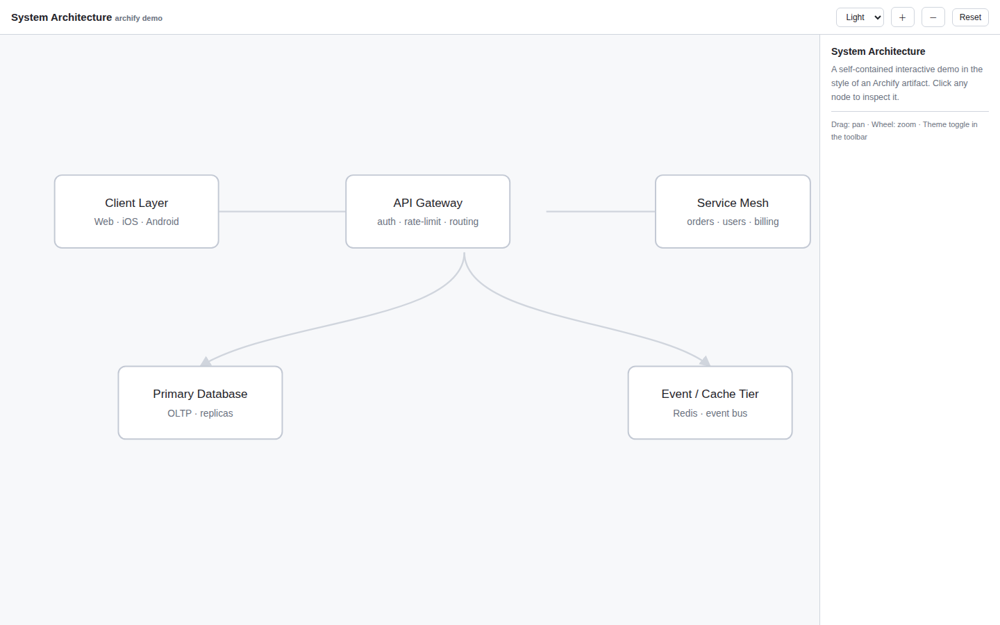

# Archify HTML Preview

**English** | [简体中文](README.zh.md)

> Click an [Archify](https://github.com/tt-a1i/archify) diagram thumbnail in your notes and explore its self-contained interactive HTML — theme toggle, pan/zoom, search, and Story mode all work — without leaving the app.



## Why this exists

Archify emits its diagrams as a set of artifacts, referenced from Markdown like this:

```markdown
[](diagrams/system-architecture.html)
```

This "image wrapped in a link" syntax is valid CommonMark, and most Markdown previews render the thumbnail and open the linked HTML interactively. In Obsidian, however, the chain breaks in four places: relative paths resolve differently, `.html` files are not recognized by default, there is no built-in HTML renderer, and a plain iframe cannot load local files.

This plugin bridges exactly those gaps: it fixes up the thumbnail, detects Archify-style links, and opens the linked HTML in a sandboxed in-app preview.

## Features

- **Card detection** — recognizes `[](x.html)` links, including Archify's naming heuristic (`*.visual-check.<W>x<H>.<theme>.png` with a sibling `*.archify.json`), and shows an "Interactive" badge on hover.
- **Broken-thumbnail repair** — re-resolves image paths using "relative to the note" semantics, so thumbnails render even when the Markdown uses GitHub-style relative paths.
- **One-click interactive preview** — open in a new tab (default), a modal, or expand inline beneath the thumbnail.
- **Source definition link** — the preview toolbar offers "Source definition" to open the sibling `.archify.json`.
- **Sandboxed by default** — runs in `sandbox="allow-scripts"` (opaque origin), so a diagram can never touch your vault files.
- **Desktop and mobile** — uses Blob URLs rather than `file://`, so behavior is identical everywhere (`isDesktopOnly: false`).

## Demo

See [`demo/demo.md`](demo/demo.md) for a working example of the Archify reference format, with a sample interactive diagram (`demo.html`) and source definition (`demo.archify.json`).

## Usage

No changes to your notes are required. Any "thumbnail linking an `.html` file" (the standard Archify output format) is enhanced automatically:

```markdown
[](architecture/diagrams/system-architecture.html)
```

Click the thumbnail to open the interactive version inside the app. There is also a command: **Open active HTML file in the interactive preview**.

## Installation

Requires Obsidian **1.4.0** or newer.

### From a release

Download `main.js`, `manifest.json`, and `styles.css` from the [latest release](../../releases/latest) into `<vault>/.obsidian/plugins/archify-html-preview/`, then enable the plugin in **Settings → Community plugins**.

### From source

```bash
npm install
npm run build
```

Copy `main.js`, `manifest.json`, `styles.css` into `<vault>/.obsidian/plugins/archify-html-preview/`. For development, `npm run dev` watches and rebuilds on change — pair it with the third-party **Hot-Reload** plugin for auto-reload.

## Settings

| Setting | Default | Description |
|---|---|---|
| Click behavior | New tab | New tab / Modal / Inline expand |

There are three surfaces, each with only the actions that make sense for it:

| Surface | Toolbar (right-aligned) | Notes |
|---|---|---|
| New tab | Refresh · Source definition · Open in browser · Open in new window | full-size view |
| Modal | Refresh · Source definition · Open in browser · Open in new window | draggable by its title, resizable from the corner, closed with the built-in button (no pop-out button — it is already a modal) |
| Inline expand | Source definition · Open in browser · Open in new window · **Collapse** | height adjustable by dragging the bottom grip (remembered) |

Buttons are right-aligned and use Obsidian's native control styling. Ctrl/Cmd +
click always opens a new tab, whatever the mode.

| Setting | Default | Meaning |
|---|---|---|
| Take over `.html` files | Off | When on, double-clicking an `.html` file also opens the interactive preview (reload the plugin after changing). Mutually exclusive with HTML Viewer / Polyglot Renderer-style plugins |
| Allow same-origin | Off | Lets previewed pages use `localStorage`, at the cost of the opaque-origin isolation |
| Inline height | 560px | iframe height for inline mode (drag the bottom grip to adjust; it is remembered) |

Everything an interactive artifact normally needs works in the preview:

- **Export** (`canvas.toBlob` + `<a download>`) — sandbox grants `allow-downloads`
- **Share actions** — popups, modals (print / confirm) and forms are allowed
- **Copy link / copy moment** — `navigator.clipboard` does not exist in an
  opaque origin, so the preview injects a runtime shim that forwards text to
  the plugin frame via `postMessage`, where the clipboard really works
- **State persistence** — `localStorage` throws in an opaque origin; the shim
  backs it with an in-memory store so artifacts keep working

**Open in browser** hands the file to a real browser. It tries, in order:
spawning a known browser executable directly (Edge / Chrome / Firefox, then the
OS opener), Obsidian's `openWithDefaultApp`, Electron's `shell.openPath` /
`shell.openExternal` (each raced against a 1.2 s timeout so a stalled bridge
cannot swallow the action), and finally the `app://` resource URL. Success is
silent; only a total failure reports — and then it copies the absolute path so
you can paste it into the address bar.

**Open in new window** pops the preview into a detached OS window owned by the
app, without touching the OS shell or any file association.

## Custom styling

All surfaces expose stable CSS hooks for user snippets
(`.obsidian/snippets/*.css`): `.archify-linked-html`, `.archify-badge`,
`.archify-inline-wrap`, `.archify-inline-grip`, `.archify-preview-view`,
`.archify-toolbar`, `.archify-preview-modal`, `.archify-frame-box`,
`.archify-float`, `.archify-float-header`, `.archify-float-title`. All colors go
through Obsidian theme variables, so light/dark themes follow automatically.

## Known limitations

- Enhanced cards (badge / inline expand) apply in Reading view and hover previews; in Live Preview, clicking relies on the "Take over `.html` files" setting.
- With the default opaque-origin sandbox, `localStorage`/`sessionStorage` are unavailable inside the preview (inherent browser behavior). Archify artifacts are self-contained so this rarely matters; enable "Allow same-origin" if a diagram needs storage.
- The `.archify.json` suffix ends in `json`, so it cannot be registered as its own file type (extension registration only looks at the last segment) — only the "Source definition" shortcut is provided.

## Localization

The settings UI, commands, badges and notices follow the app's interface
language automatically. Currently included: **English, 简体中文, 繁體中文, 日本語**.
The full documentation is also available in [简体中文](README.zh.md).
Contributions for other languages are welcome — add a dictionary in
[`src/i18n.ts`](src/i18n.ts) and register it in the `STRINGS` map.

## Project structure

```
├── src/
│   ├── main.ts        # plugin entry: registration, markdown enhancement, click routing
│   ├── resolve.ts     # path resolution + Archify metadata parsing
│   ├── settings.ts    # settings interface, defaults, settings tab
│   ├── view.ts        # sandboxed iframe, ItemView, Modal, inline child
│   └── i18n.ts        # localization (en / zh / zh-TW / ja)
├── demo/              # sample note + interactive HTML + source definition
├── esbuild.config.mjs
├── manifest.json
├── styles.css
└── versions.json
```

## Releasing (community plugin submission)

1. Bump `version` in `manifest.json` and mirror it in `versions.json` (`{"<version>": "<minAppVersion>"}`).
2. Push a tag named exactly the version (no `v` prefix) — the bundled GitHub Actions workflow builds and attaches `main.js`, `manifest.json`, `styles.css` to the release.
3. Open a PR against [obsidian-releases](https://github.com/obsidianmd/obsidian-releases) adding this repo to `community-plugins.json`, following the [Plugin guidelines](https://docs.obsidian.md/Plugins/Releasing/Plugin+guidelines).

## Credits

- [Archify](https://github.com/tt-a1i/archify) by tt-a1i — the agent skill that produces these interactive architecture diagrams.

## License

[MIT](LICENSE)
