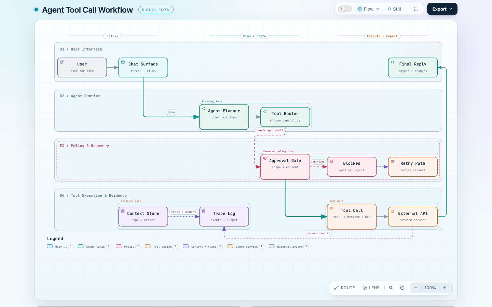

# Archify HTML Preview — Demo

This note uses the standard Archify output format: a `visual-check` thumbnail
wrapped in a link to the self-contained interactive HTML.

> Click the thumbnail to open the interactive version (theme toggle, pan/zoom,
> node search, route tracing, presentation mode). Source definition:
> [agent-tool-call.workflow.json](agent-tool-call.workflow.json).

The diagram is the **Agent Tool Call Workflow** flowchart from the
[Archify README](https://github.com/tt-a1i/archify) (Workflow example), rendered
with Archify 3.1.0 — a real bundle in the current naming conventions:

| File | What it is |
|---|---|
| `agent-tool-call.workflow.html` | self-contained interactive artifact |
| `agent-tool-call.workflow.json` | typed source definition (`<name>.<type>.json`) |
| `agent-tool-call.workflow.visual-check.1440x900.light.png` | standard `visual-check` capture (also the README screenshot) |

The thumbnail follows the Archify naming convention
`<name>.visual-check.<width>x<height>.<theme>.png`, which the plugin detects to
show the "Interactive" badge and link back to the source definition.
